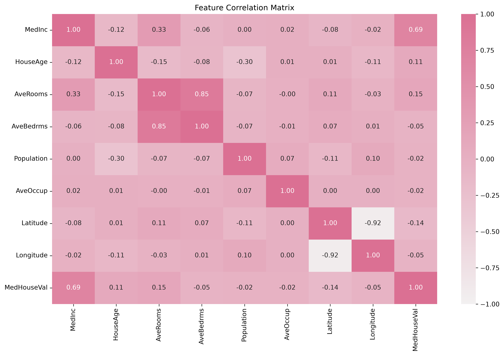
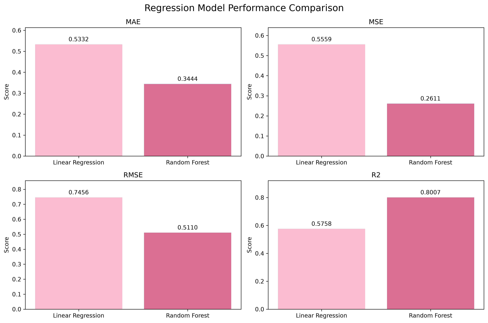
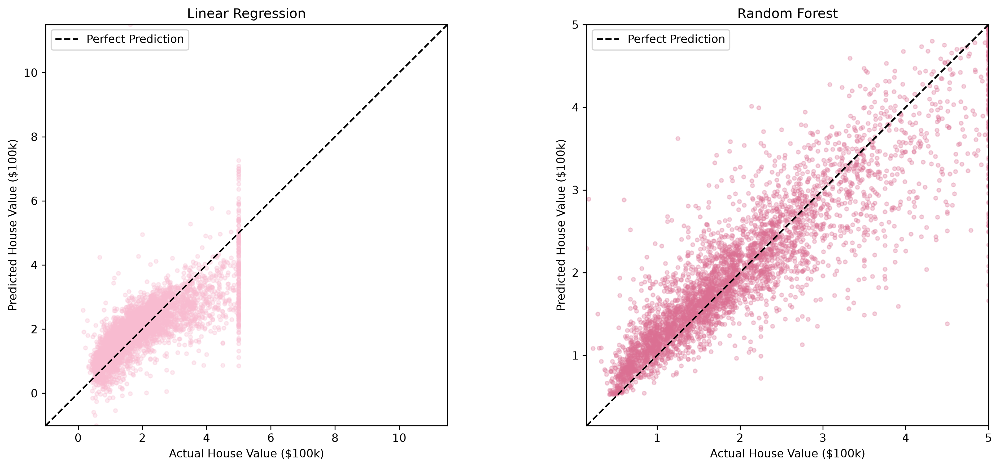
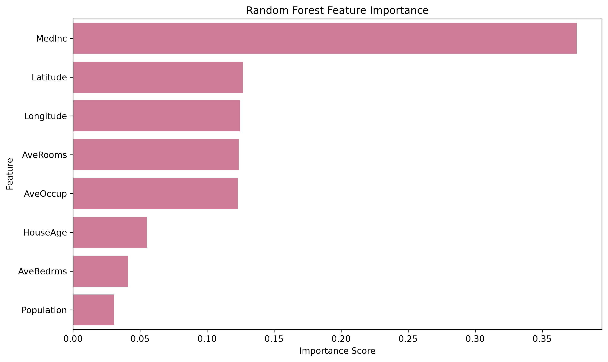
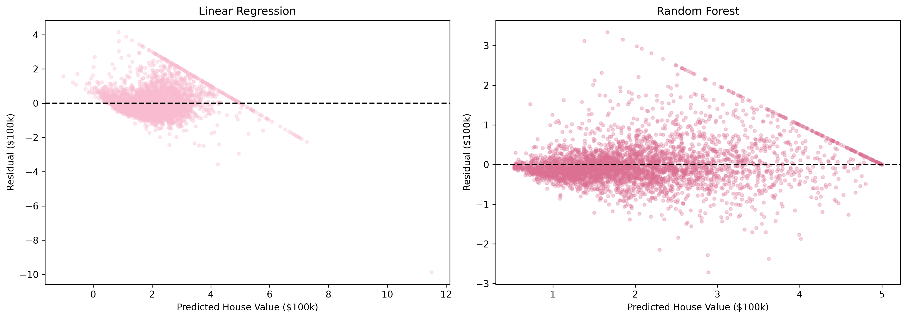

# California Housing Price Prediction

## Project Overview

An end-to-end machine learning project that predicts median house values in California using Linear Regression and Random Forest Regression. The project demonstrates the complete machine learning workflow, including exploratory data analysis, data preprocessing, model training, performance evaluation, feature importance analysis, model serialization, and inference.

## Dataset

The California Housing dataset is available through Scikit-learn and is based on the 1990 U.S. Census.

- **Samples:** 20,640
- **Input features:** 8
- **Target variable:** Median house value
- **Task:** Supervised learning — regression
- **Training samples:** 16,512
- **Testing samples:** 4,128
- **Train-test split:** 80:20
- **Random seed:** 42

### Input Features

| Feature | Description |
|---|---|
| MedInc | Median household income |
| HouseAge | Median house age |
| AveRooms | Average number of rooms per household |
| AveBedrms | Average number of bedrooms per household |
| Population | Block group population |
| AveOccup | Average household occupancy |
| Latitude | Geographic latitude |
| Longitude | Geographic longitude |

## Machine Learning Workflow

1. Data loading and inspection
2. Exploratory data analysis
3. Missing value and duplicate detection
4. Train-test splitting
5. Linear Regression training
6. Random Forest Regression training
7. Model evaluation and comparison
8. Feature importance analysis
9. Residual analysis
10. Model serialization and inference

## Exploratory Data Analysis

The dataset contains no missing values or duplicate rows. Median income has the strongest positive Pearson correlation with median house value (r = 0.6881).



## Models

### Linear Regression

An ordinary least squares regression model used as a baseline for predicting continuous house values.

### Random Forest Regression

An ensemble learning model that combines predictions from multiple decision trees.

Hyperparameters:

- n_estimators: 100
- max_depth: 15
- max_features: sqrt
- random_state: 42
- n_jobs: -1

## Model Performance

| Model | MAE | MSE | RMSE | R² |
|---|---:|---:|---:|---:|
| Linear Regression | 0.5332 | 0.5559 | 0.7456 | 0.5758 |
| Random Forest | 0.3444 | 0.2611 | 0.5110 | 0.8007 |

The Random Forest model achieved:

- 53.03% reduction in mean squared error
- 35.41% reduction in mean absolute error
- 31.46% reduction in root mean squared error
- R² of 0.8007
- Mean absolute prediction error of $34,441.78



## Actual vs. Predicted Values

Random Forest produced predictions that were generally closer to the observed target values than those generated by Linear Regression.



## Feature Importance

Median income was the most influential feature according to the Random Forest's impurity-based feature importance measure, followed by latitude, longitude, and average number of rooms.



## Residual Analysis

Random Forest reduced prediction errors compared with the linear baseline. However, nonconstant residual variance and systematic prediction errors remain.



## Key Findings

- Random Forest outperformed Linear Regression across all four evaluation metrics.
- Median income was the most important feature in the Random Forest model.
- Geographic features contributed substantially to prediction despite their relatively weak individual Pearson correlations with house values.
- Nonlinear modeling captured relationships that were not adequately represented by the linear baseline.
- Model serialization and reloading preserved predictions within numerical tolerance.

## Model Inference

The trained Random Forest model was saved using Joblib and successfully reloaded for inference.

An illustrative prediction for a hypothetical residential block group produced an estimated median house value of $313,751.86.

## Limitations

- The dataset is based on historical census data and does not represent current housing market prices.
- The target variable is capped at approximately $500,001, limiting the modeling of higher house values.
- Extreme values were retained in the baseline experiments.
- The difference between training and testing errors suggests potential overfitting.
- Hyperparameter optimization and cross-validation were not performed.
- Random train-test splitting may overestimate generalization to geographically distinct regions.
- Impurity-based feature importance does not establish causal relationships.

## Future Improvements

- Hyperparameter optimization using GridSearchCV or RandomizedSearchCV
- Cross-validation and spatial validation
- Outlier analysis and feature engineering
- Comparison with XGBoost and Gradient Boosting
- Permutation importance and SHAP-based model interpretation
- Deployment through a Streamlit application or REST API

## Technologies

- Python
- NumPy
- Pandas
- Scikit-learn
- Matplotlib
- Seaborn
- Joblib
- Jupyter Notebook

## Installation

Clone the repository:

```bash
git clone https://github.com/yungweiwang/california-housing-prediction.git
cd california-housing-prediction
```

Create and activate a virtual environment:

```bash
python3 -m venv .venv
source .venv/bin/activate
```

Install dependencies:

```bash
pip install -r requirements.txt
```

Open `notebooks/housing_prediction.ipynb` in Jupyter Notebook or VS Code and run all cells.

The dataset is downloaded automatically through Scikit-learn when required.
